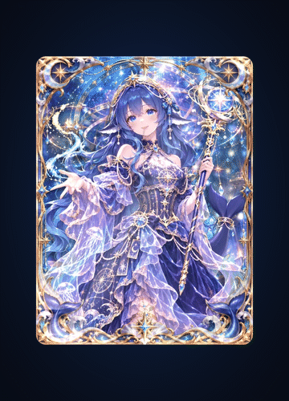
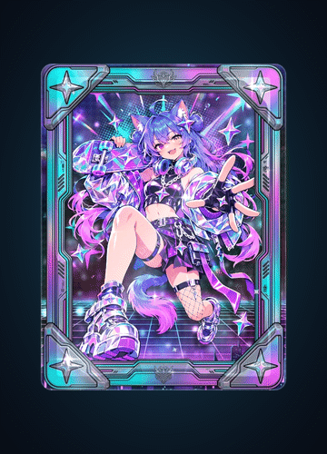

# `holo-card-3d` · 3D Holo Quicksand Collector Card Skill (v2.1)

Turn any character illustration or reference image into a **3D holographic flowing-quicksand (流麻) SAR/UR collector card** with 11+3 perspective relief mapping, metallic embossed bevels, pixel-exact prop light sweeps, and analytical SDF motion motifs — exported as an offline **60fps WebGL2 HTML**, **zero-ghosting transparent WebP**, and **GIF** bundle.

Portable cross-harness Agent Skill for **Antigravity**, **Codex**, and **Claude Code**.

<p align="center">
  
  &nbsp;&nbsp;&nbsp;
  
</p>

---

## Highlights (`v2.1`)

- **3-Layer + Relief-Depth Architecture**: Deep holographic background (`1.07×` overscan) + gravity-reactive flowing quicksand & 300 3D micro-sequins + Alpha-gated perspective relief-mapped subject + flush multi-slice metallic frame bevel.
- **"1+1" Bespoke Polish (Zero Extra AI Image Gen)**:
  1. **1 Pixel-Exact Prop Light FX (`prop_fx`)**: Interactive `0.05` UV grid ruler (`--stage prop-grid`) + hand-excluding polygon mask (`prop_mask.png`) drives a single directional specular/prism gleam along your hero prop (staff, sword, skateboard, spellbook, etc.), triggering one hairline expanding ring & needle star at the tip.
  2. **1 Analytical SDF Motion Motif (`motion_motif`)**: Crisp dual-depth drifting shapes with face protection (`feathers_bubbles`, `cyber_stars`, `petals`, `embers`, `snowflakes`, or `none`).
- **Standardized 3-File Deliverable Bundle (`<workdir>/output/`)**:
  - `holographic_card.html` — Single-file offline 60fps WebGL2 interactive card (`±30°/±19°` drag & mobile gyro, `流畅`/`高清`, 3 studio modes).
  - `holographic_card.webp` — `690×960` transparent RGBA animated WebP (`84f @ 60ms = 5.04s`, zero-ghosting `dispose=1, no_blend=1`).
  - `holographic_card.gif` — `460×640` themed studio-backdrop GIF (`84f @ 60ms = 5.04s`, shared 256-color Median Cut + Floyd–Steinberg).
- **Works With or Without Built-in Image Gen**: Includes prompt templates (`references/prompt-templates.md`) and 3 ready-to-use `1200×1600` collector frames (`assets/frames/`).

---

## Installation

### 1. Install Python Dependencies
```bash
pip install numpy pillow opencv-python
```

### 2. Install as an Agent Skill
Clone this repository into your agent's skills directory (or symlink/junction to one shared copy):

```bash
# Codex
git clone https://github.com/deepslit/holo-card-3d.git ~/.codex/skills/holo-card-3d

# Claude Code
git clone https://github.com/deepslit/holo-card-3d.git ~/.claude/skills/holo-card-3d

# Antigravity (project or global skills)
git clone https://github.com/deepslit/holo-card-3d.git <workspace>/.agents/skills/holo-card-3d
```

---

## Quick Start (CLI Pipeline)

```bash
# 1. Inspect or auto-matte raw layers (01_raw_layers/ -> 02_matted/)
python scripts/run_pipeline.py --workdir ./my_card --stage matte

# 2. (Optional v2.1) Export 0.05 UV grid to trace prop_fx polygons in card_config.json
python scripts/run_pipeline.py --workdir ./my_card --stage prop-grid

# 3. Align/synthesize depth, build masks & prop_mask.png (03_processed/)
python scripts/run_pipeline.py --workdir ./my_card --stage prepare

# 4. Build 60fps HTML + render 84-frame WebP/GIF + verify all QA invariants
python scripts/run_pipeline.py --workdir ./my_card --stage html
python scripts/run_pipeline.py --workdir ./my_card --stage render
python scripts/run_pipeline.py --workdir ./my_card --stage verify
```

Or run the entire pipeline in one command after placing `card_config.json` and `01_raw_layers/`:
```bash
python scripts/run_pipeline.py --workdir ./my_card --stage all
```

---

## Repository Layout

```text
holo-card-3d/
├── SKILL.md                  # Cross-harness agent instructions (v2.1)
├── README.md                 # Project overview & gallery
├── LICENSE                   # MIT License
├── agents/openai.yaml        # Codex UI metadata
├── assets/
│   ├── card_config.example.json
│   ├── palettes.json
│   └── frames/               # Built-in 1200x1600 RGBA collector frames
├── docs/                     # README showcase GIFs
├── references/
│   ├── prompt-templates.md   # Layer generation prompts
│   └── standard-spec.md      # Frozen optical, motion & QA invariants
└── scripts/
    ├── run_pipeline.py
    ├── matte_layers.py
    ├── build_prop_mask.py
    ├── prepare_assets.py
    ├── build_html_card.py
    ├── render_card.py
    └── verify_outputs.py
```

---

## License

[MIT](LICENSE)
