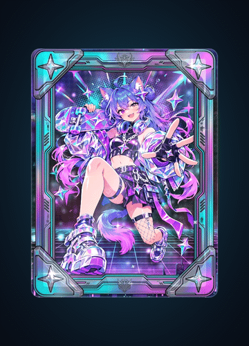

# `holo-card-3d` · 3D 全息流麻收藏卡技能 (v2.3)

**[English](README.md)** | **简体中文**

把任意角色立绘或参考图制作成 **3D 全息流麻（流动闪粉）SAR/UR 收藏卡**：内置 11+3 视角视差浮雕映射、8 款矢量 SDF 立体边框与动态金属着染、6 款工艺材质 × 5 款棚拍光影 × 6 款全息底纹（面部保护顶层覆膜）、可选像素级道具扫光（`prop_fx`）与解析场 SDF 飘落粒子（`motion_motif`），一次导出离线 **`60 fps` WebGL2 交互展柜 HTML（内置工艺实时试看 + 纯前端离线 WebP/GIF 导出）**、**`~16.7 fps` 零残影透明 WebP** 与 **`~16.7 fps` 棚拍背景 GIF** 三件套。

遵循开放的 **`SKILL.md` 标准**，同时提供独立 CLI 管线 —— 兼容**所有主流智能体 Harness 与编程 CLI**（Claude Code、Codex、Antigravity、Cursor、Windsurf、Gemini CLI、OpenCode、Cline、GitHub Copilot、Trae 等）。

<p align="center">
  
  &nbsp;&nbsp;&nbsp;
  
</p>

### 展柜级 Web 交互界面与实时工艺试看 (`v2.3`)

<p align="center">
  
  <br />
  <sub>20 fps 无缝循环预览 · <a href="docs/demo_web_ui.mp4">查看 / 下载 30 fps 高清 MP4（1040×660）</a></sub>
</p>

---

## ⚡ 最快上手：直接把这句话发给你的智能体

不需要手动配环境或敲命令——把参考图连同下面这句话，直接发给**任意支持技能或命令行的智能体**：

```text
帮我下载并安装技能 https://gitee.com/deepslit/holo-card-3d，然后用它把这张图做成 3D 流麻闪卡
```

> - **GitHub 主仓库地址**：`https://github.com/deepslit/holo-card-3d`（两个地址代码实时自动同步，国内推荐用 Gitee 镜像更快）
> - **已经安装过技能？** 后续直接发图并说：`用 holo-card-3d 把这张图做成 3D 流麻闪卡` 即可。

---

## 核心亮点 (`v2.3`)

- **全新美术馆展柜 Web UI + 100% 纯前端离线 GPU 导出**：
  - 极简黑白物理质感展柜界面，支持**暗绒展台 / 黑曜纯黑 / 画廊亮白**三档展台与深/浅双主题自动适配、**右上角 `EN / 中文` 一键中英切换**（默认自动跟随浏览器语言，亦支持配置 `ui_lang`）、四角发丝取景框、单行磨砂悬浮控制岛、`H` 一键纯净赏卡、双击归零、零 GC 60fps 渲染循环与后台标签页自动暂停。
  - **实时「工艺」弹层**：在网页里以 60fps 零等待实时切换全部 **6 款材质、5 款光影、6 款底纹**，所见即所得。
  - **网页内一键离线导出（绝不覆盖原文件）**：调出满意组合后，直接在单文件 HTML 里通过 WebGL2 离屏 FBO + 纯原生 JS 编码器几秒导出 **`690×960` 零残影透明 WebP** 与 **`460×640` 256 色抖动 GIF**（零外部 CDN、无需本地服务器，文件名自动拼接工艺后缀，不覆盖原目录成品），并支持一键复制 JSON 参数。
- **6 款工艺材质 × 5 款棚拍光影 × 6 款全息底纹（WebGL2 / CPU 双端 1:1 同步）**：
  - 顶层光学覆膜严格通过 `face_box` 保护人物脸部纯净无干扰，满画幅卡也能清晰呈现质感变化：
  - **材质 (`material_preset`)**：`sar_quicksand`（经典流麻 SAR）、`acrylic_brick`（1.85× 晶透厚边 + 内棱折射 + 前景微闪亚克力砖）、`cracked_ice`（Voronoi 多边形碎冰晶面闪）、`etched_foil`（等高线压纹浮雕金属箔）、`matte_velvet`（柔雾哑光丝绒 + 2.55× 局部 UV 烫金）、`clean_tcg`（纯净经典彩虹闪卡，零流沙）。
  - **光影 (`lighting_preset`)**：`gallery_neutral`（展柜均衡）、`dramatic_rim`（戏剧双色轮廓光）、`golden_hour`（暖阳鎏金）、`moonlit_prism`（冷月幽光）、`soft_pastel`（日系柔光箱）。
  - **底纹 (`holo_pattern`)**：`starburst`（星芒）、`prism_grid`（马赛克棱镜格）、`cosmos_waves`（星海波）、`cracked_ice`（碎冰晶）、`diagonal_foil`（斜向拉丝）、`diamond_lattice`（菱格暗纹）。
- **8 款矢量 SDF 内置边框 + 动态金属着染 (`frame_tint`)**：
  - `classic_sar_gold`（典藏金）、`minimal_platinum`（极简铂金）、`cyber_hud_frame`（赛博 HUD）、`full_art_glass`（极细无框亚克力透卡边）、`baroque_arch`（新艺术复古拱门）、`eastern_ink`（国风海棠角/回纹窗棂）、`y2k_polaroid`（Y2K 胶片拍立得）、`gothic_spire`（暗黑哥特尖拱）。
  - `frame_tint: "auto"` 按当前 `theme_palette` 对内置边框做保亮度金属着染（用户自定义 `fg` 默认原样保留）。
- **6 款 0 生图纯算法程序化背景 (`bg_preset`)**：
  - `celestial_nebula`（深空星云光门）、`stained_glass`（圣堂彩窗）、`cyber_grid`（赛博透视网格）、`ink_wash`（水墨宣纸洒金）、`pastel_bokeh`（马卡龙柔光散景）、`obsidian_velvet`（暗黑棚拍丝绒）。
- **三路线意图优先（支持零 AI 生图直出）**：
  - **路线 1（零生图 — 保留原图像素）**：只需放入一张图到 `01_raw_layers/mid.*`。原生透明 RGBA、绿/洋红/蓝幕与纯色底自动干净抠出并搭配程序化 `bg_preset` 背景；**自带复杂背景的完整插画或照片默认满画幅不透明直出（`none`）**，不再自动运行 OpenCV GrabCut，100% 保留原画并通过浮雕深度、立体边框与顶层工艺覆膜呈现高级闪卡质感。
  - **路线 2（混合路线）**：保留原图角色像素，仅替换背景/边框（或反过来）。
  - **路线 3（AI 重绘）**：调用内置生图工具或使用 `references/prompt-templates.md` 提示词模板进行风格化重构与 TCG 重绘。
- **渲染前资产体检、3 秒快速预览门控与可选「1+1」点睛特效**：
  - 支持智能安全构图 `mid_fit: "auto"`、`--stage preview`（3 秒双角度预检）、可控卡面铭牌 `label_mode`（`page_only` / `on_card` / `hidden`）、像素级道具扫光 `prop_fx` 与解析场 SDF 粒子 `motion_motif`。
- **标准化三件套交付（`<workdir>/output/`）**：
  - `holographic_card.html` — 单文件离线 **`60 fps`** WebGL2 交互展柜 + 实时工艺弹层 + 离线 GPU 导出。
  - `holographic_card.webp` — `690×960` 透明通道动态 WebP（**`84 帧 @ 60ms` ≈ `16.7 fps`, `5.04s`**，`dispose=1, no_blend=1` 零残影）。
  - `holographic_card.gif` — `460×640` 主题棚拍背景 GIF（**`84 帧 @ 60ms` ≈ `16.7 fps`, `5.04s`**，共享 256 色 Median Cut + Floyd–Steinberg 抖动）。

---

## 手动安装与环境自检

### 1. 检查 Python 环境并安装依赖
```bash
# 纯标准库预检（自动识别 Windows Store 占位 python、版本、依赖包、磁盘与内存）
python scripts/check_env.py

# 安装已验证兼容版本的依赖
pip install -r requirements.txt
```

### 2. 手动安装到智能体技能目录（通用任意 Harness）
`holo-card-3d` 基于开放的 [`SKILL.md`](SKILL.md) 规范编写，无任何私有绑定，支持所有可读取 `SKILL.md` 或可执行命令行的智能体 Harness：

```bash
# 通用跨智能体项目技能目录（Antigravity、Codex、Gemini CLI、OpenCode、Copilot 等）
git clone https://gitee.com/deepslit/holo-card-3d.git .agents/skills/holo-card-3d

# 或各工具全局技能目录示例：
git clone https://gitee.com/deepslit/holo-card-3d.git ~/.claude/skills/holo-card-3d   # Claude Code
git clone https://gitee.com/deepslit/holo-card-3d.git ~/.codex/skills/holo-card-3d    # Codex
git clone https://gitee.com/deepslit/holo-card-3d.git ~/.cursor/skills/holo-card-3d   # Cursor
```

> **兜底用法**：即使你的智能体工具不支持自动扫描 `skills` 目录，也可以把仓库克隆到任意位置，直接让它「阅读 `SKILL.md` 并调用 `scripts/run_pipeline.py`」。

---

## 独立 CLI 管线用法

```bash
# 0. 验证 Python 解释器与依赖
python scripts/check_env.py --workdir ./my_card

# 1. 本地处理（RGBA / 色键 / 纯色抠图；复杂背景原画默认满画幅直出 none）
python scripts/run_pipeline.py --workdir ./my_card --stage matte

# 2. 对齐与深度生成、程序化 bg_preset 与动态 frame_tint、资产体检与遮罩生成
python scripts/run_pipeline.py --workdir ./my_card --stage prepare

# 3. 约 3 秒快速双角度预览（全量渲染前先检查 03_processed/preview_composite.png）
python scripts/run_pipeline.py --workdir ./my_card --stage preview

# 4. （可选）导出 0.05 UV 网格坐标图，用于标定 card_config.json 中的 prop_fx 多边形
python scripts/run_pipeline.py --workdir ./my_card --stage prop-grid

# 5. 生成 60fps 交互 HTML（含实时工艺切换与离线导出）+ 渲染 WebP/GIF + 技术校验
python scripts/run_pipeline.py --workdir ./my_card --stage html
python scripts/run_pipeline.py --workdir ./my_card --stage render
python scripts/run_pipeline.py --workdir ./my_card --stage verify
```

准备好 `card_config.json` 与 `01_raw_layers/` 后，也可以一条命令跑完全流程：
```bash
python scripts/run_pipeline.py --workdir ./my_card --stage all
```

---

## 仓库目录结构

```text
holo-card-3d/
├── SKILL.md                  # 跨 Harness 通用智能体指令 (v2.3)
├── README.md                 # 英文说明文档
├── README.zh-CN.md           # 中文说明文档
├── requirements.txt          # Python 依赖版本约束
├── LICENSE                   # MIT 开源协议
├── agents/openai.yaml        # 可选 Codex UI 元数据
├── assets/
│   ├── card_config.example.json
│   ├── palettes.json
│   └── frames/               # 8 款内置 1200x1600 矢量 SDF RGBA 收藏卡边框
├── docs/                     # README 演示动图（成卡展示 & Web UI 演示）
├── references/
│   ├── prompt-templates.md   # 路线 2/3 分层生图提示词模板
│   └── standard-spec.md      # 光学、预设、动态、Asset Lint 与 QA 规范
└── scripts/
    ├── check_env.py          # 跨平台解释器、依赖、磁盘与内存预检
    ├── run_pipeline.py
    ├── generate_builtin_frames.py # 8 款内置收藏卡边框 SDF 生成器
    ├── matte_layers.py       # RGBA / 色键 / 纯色抠图 & 复杂背景满画幅直出
    ├── build_prop_mask.py
    ├── prepare_assets.py     # 智能构图、6 款程序化背景、边框动态着染、资产体检
    ├── build_html_card.py    # 60fps 展柜级 HTML、实时工艺弹层与离线 WebP/GIF 导出
    ├── render_card.py        # 3 秒快速预览与 84 帧 CPU WebP/GIF 渲染器
    └── verify_outputs.py     # 客观技术校验 + 视觉 QA 检查单
```

---

## 开源协议

[MIT](LICENSE)

## 主题包（v2.3+）

七套配套的背景 + 边框，单张图、不需要生图也能做出接近四层精修的卡：`gothic_moon` 哥特月夜、`dunhuang_mural` 敦煌壁画、`mecha_hangar` 机库工业、`pixel_quest` 像素冒险、`candy_shop` 糖果小铺、`royal_pet` 皇家萌宠、`toy_capsule` 扭蛋游乐园。

```bash
python scripts/theme_packs.py --list
python scripts/theme_packs.py --apply gothic_moon --workdir <workdir>
```

另外新增破框效果：在 `card_config.json` 里设置 `"breakout": {"enabled": true}`，主体上半部分会压在边框之上。
